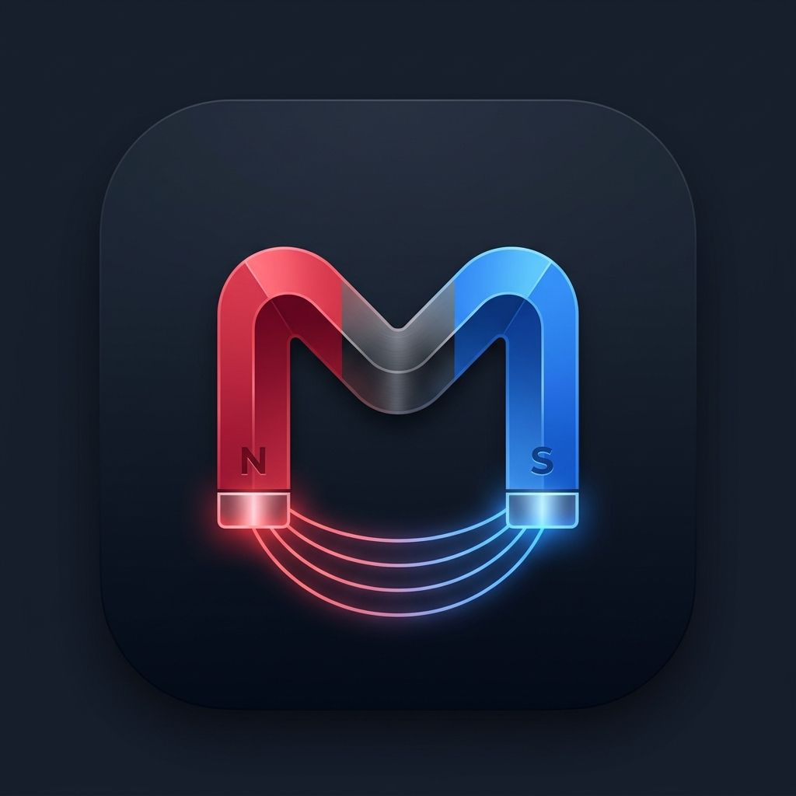

<div align="center">



# Magnin
### Tangible Magnetic Input & Kinematic Interaction Engine for Android

[-brightgreen?style=flat-square&logo=android)](https://developer.android.com)
[](https://kotlinlang.org)
[](https://developer.android.com/jetpack/compose)
[](LICENSE)
[]()

<p align="center">
  <strong>Transform raw smartphone magnetometer flux into expressive physical controllers.</strong><br>
  Continuous rotary knobs, pitch levers, gated directional joysticks, and 3D spatial tilt using everyday neodymium magnets.
</p>

</div>

---

## 🧭 Overview

**Magnin** (*Magnetic Input*) turns your Android device's built-in 3-axis Hall-effect magnetometer into a high-precision, touchless tangible controller interface. 

By tracking spatial variations in magnetic dipole flux density ($\vec{B} = [B_x, B_y, B_z]$) caused by moving or tilting an external magnet, **Magnin** maps microTesla ($\mu\text{T}$) readings into clean kinematic primitives. It allows you to anchor a magnetic stylus, stick, or knob to or near the phone surface and interact seamlessly without capacitive touchscreen occlusion.

---

## 🕹️ Kinematic Control Modes

Magnin decomposes 3D magnetic flux vectors into four distinct mechanical degrees of freedom:

| Mode | DOF | Interaction Paradigm | Ideal Use Cases |
| :--- | :--- | :--- | :--- |
| **`DIAL`** | 1-DOF Rotary | Precession angle tracking ($0^\circ \to 360^\circ$) around the stick/magnet axis | Volume scrubbers, radial menus, rotary dials, DJ decks |
| **`LEVER`** | 1-DOF Pitch | Forward/backward tilt deflection angle ($0^\circ \to 90^\circ$) | Audio faders, linear vehicle throttles, brightness sliders |
| **`JOYSTICK`** | 2-DOF Gated | 8-way directional vector quantization with deadzone hysteresis | D-pad gaming controls, list pagination, cursor navigation |
| **`FREE`** | 2-DOF Spatial | Full continuous spatial elevation and clock heading tracking | Spatial 3D orientation, camera panning, flight pitch & yaw |

---

## 📱 Interactive Visualizer Suite

The included sample application showcases four interactive visualizers and test environments:

1. **Iron Filings**: Simulates a physical grid of microscopic ferromagnetic needles that rotate in real-time along magnetic field vectors.
2. **Flux Ripples**: Generates dynamic wave ripple wavefronts scaled to magnetic flux intensity, with color-coded North (Cyan) and South (Red) polarity cues.
3. **3D Gimbal**: Renders an interactive 3-axis concentric gimbal ring displaying live Euler rotation angles and tilt elevations.
4. **Dial**: A clean, blank canvas with all numeric HUD telemetry suppressed—designed specifically for integrating and testing custom user components.

---

## ⚡ Core Architecture

```
com.magnet.id/
├── data/
│   ├── model/
│   │   ├── MagneticReading.kt       # 3-axis raw vectors, net flux, clock heading & tilt
│   │   ├── KinematicConstraint.kt   # FREE, DIAL, LEVER, JOYSTICK solvers
│   │   ├── GroundReference.kt       # Surface baseline leveling and offset cancellation
│   │   └── SensorCalibration.kt     # Physical chip coordinate mapper
│   └── repository/
│       └── CalibrationRepository.kt # Persistent SharedPreferences state
├── sensor/
│   └── MagnetometerManager.kt       # 60Hz SENSOR_DELAY_FASTEST hardware listener
└── ui/
    ├── playground/
    │   ├── canvas/                  # Vector field & ripple rendering pipelines
    │   └── components/              # Minimalist HUD overlay & scrollable selector
    └── calibration/                 # Guided 5-point sweet-spot calibration wizard
```

### Key Technical Capabilities

* **Geomagnetic Ambient Tare (`[TARE]`)**: Instantaneously cancels ambient Earth magnetic background ($\approx 30\text{--}60\,\mu\text{T}$) and stray EMI noise.
* **Ground Reference Zeroing (`[GND]`)**: Eliminates tilt bias caused by the phone resting on an incline or desk, ensuring a true perpendicular upright baseline ($90^\circ$ elevation).
* **Hardware Sweet-Spot Snapping (`[SNAP]`)**: Maps and snaps to the exact physical silicon location of the phone's internal magnetometer IC (e.g., $(0.08, 0.08)$ top-left perimeter on Samsung Galaxy devices).

---

## 🚀 Getting Started

### Prerequisites

* Android Studio Ladybug (2024.2+) or newer
* JDK 17
* Android device running Android 8.0 (API 26) or higher with an onboard compass / magnetometer sensor

### Installation

```bash
# Clone the repository
git clone https://github.com/PrashantNaikHC/MagnIn.git
cd MagnIn

# Build the debug APK
./gradlew assembleDebug

# Install on a connected ADB device
./gradlew installDebug
```

---

## 🧲 Physical Setup Recommendations

* **Magnet**: Neodymium (NdFeB) N35–N52 button or disc magnet ($6\text{mm} \times 3\text{mm}$ or $10\text{mm} \times 2\text{mm}$).
* **Stylus / Stick**: Non-ferromagnetic shaft (wood, acrylic, or 3D-printed PLA/PETG) with the magnet bonded to one end.
* **Surface Anchor**: Place the magnet base near the top-left sensor area of your device for maximum signal-to-noise ratio and dynamic range.

---

## 📄 License

This project is open-source under the [MIT License](LICENSE).
